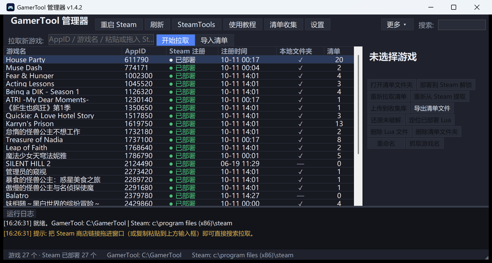
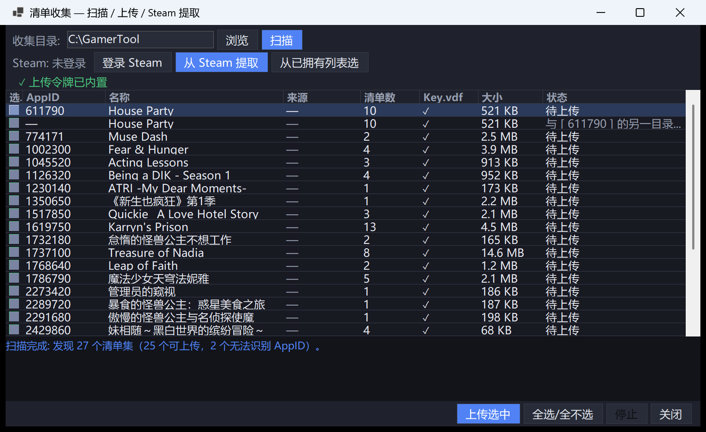
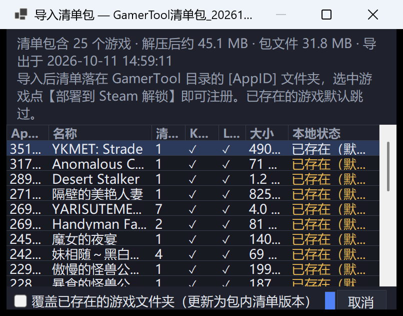
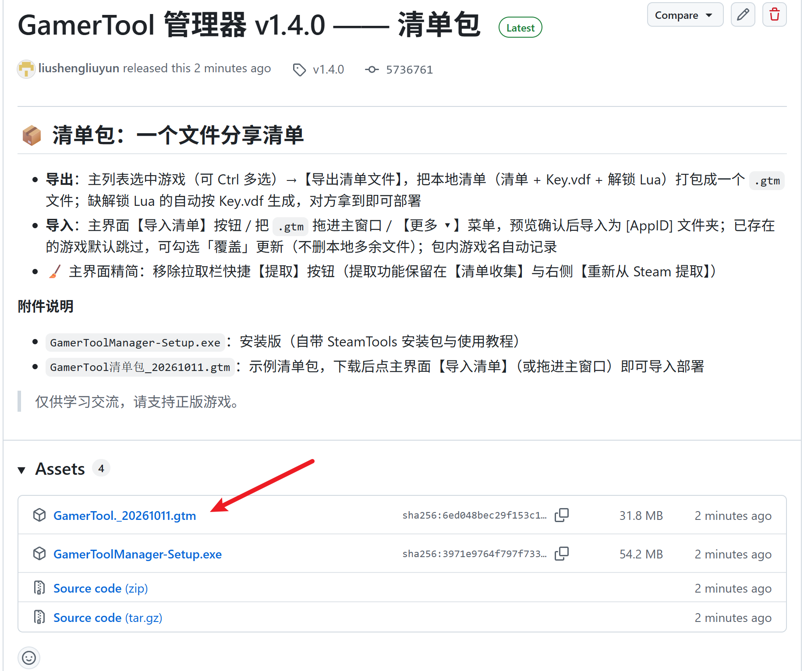
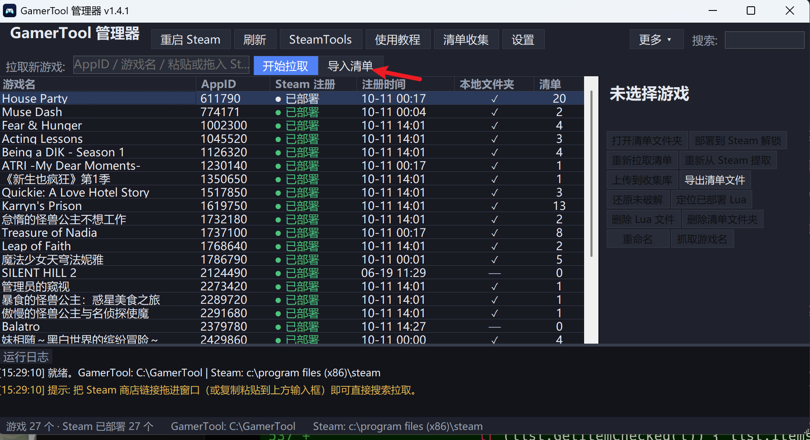
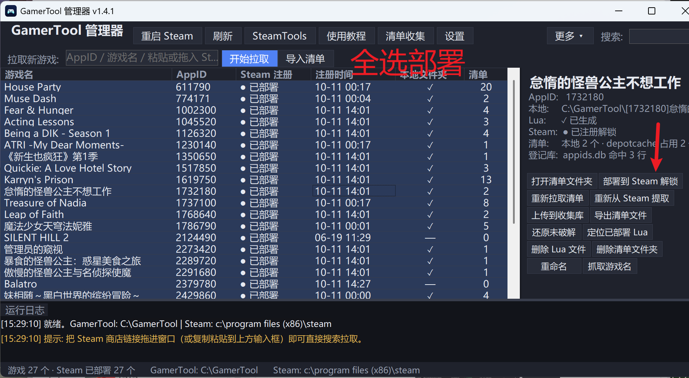

# GamerTool 管理器

一款 Steam 清单解锁管理工具：**拉取清单 → 生成解锁 Lua → 部署注册到 Steam**，并支持**一键还原未破解**。内置网络引擎（多镜像并行下载），无需任何外部工具；也可手动配合 SteamTools 悬浮窗使用。

> 仅供学习交流，请支持正版游戏。



## ✨ 功能

| 功能 | 说明 |
|---|---|
| 📥 拉取清单 | 输入 AppID / 游戏名 / 粘贴商店链接，自动从多个清单仓库（分支即 AppID 的组织形式）检索并下载清单与 Key.vdf，**多任务并发** |
| 🛜 清单提取 | 登录自己的 Steam 账号（Steam Guard 支持，本机只存 refresh token 不存密码），从**已拥有**的游戏直接提取 depot 密钥与最新 manifest，生成与拉取同构的 `[AppID]` 目录 |
| 📤 清单收集 | 扫描收集目录（`[AppID]` 文件夹 / 散装 manifest+Key.vdf），批量上传到社区收集库 [GamerToolManifests](https://github.com/liushengliuyun/GamerToolManifests)（一个 AppID 一个分支），SHA 去重、只增不删、冲突保护；该仓库同时加入拉取镜像末尾，形成 提取→上传→拉取 闭环 |
| 📦 清单包 | 把选中的本地清单（支持 Ctrl 多选）导出成**一个 .gtm 文件**分享；对方点主界面【导入清单】选择文件或把 .gtm 拖进主窗口即可导入，导入后选中即可部署 |
| 🚀 部署解锁 | Lua → `stplug-in`、清单 → `depotcache`、addappid 目标登记进 `appids.db`，等价于拖 SteamTools 悬浮窗 |
| ↩️ 还原未破解 | 精确删除该游戏的 Lua / 清单 / 登记行；支持一键"还原全部" |
| 🌐 联网补名 | Steam 官方接口抓中文名，直连失败自动走代理 |
| 🧹 孤儿登记清理 | 清理 appids.db 中无 Lua 覆盖的残留登记 |
| 🪟 布局记忆 | 窗口宽高、分割线位置、最大化状态关窗即存 |
| 🎨 细节 | 双击复制游戏名/AppID、注册时间显示与排序、空文件夹标记、回收站删除、CJK/高 DPI 自适应布局 |

## 📦 下载

到 [Releases](../../releases) 页面下载 **`GamerToolManager-Setup.exe`**（安装版，推荐）：

- 内置 SteamTools 1.8.30 安装包与使用教程，装完可在程序内一键安装 SteamTools
- 自动创建开始菜单/桌面快捷方式，带卸载器

> 便携版自 v1.2.1 起不再提供：缺少 SteamTools 安装包与教程文件，体验不完整，统一使用安装版。

## 🧰 使用前置

1. **Steam** 已安装并登录
2. **SteamTools** 已安装并保持运行（程序会在未安装时引导你安装）
3. Windows 10/11 x64（无需 .NET 运行时，自带）

## 🚀 快速上手

```
① 拉取：主页面输入框输入 AppID 或游戏名 → 回车
② 部署：列表选中游戏 → 点【部署到 Steam 解锁】→ 按提示重启 Steam
③ 游玩：Steam 库里出现游戏，正常下载
④ 还原：【还原未破解】恢复原状
⑤ 收集：【清单收集】登录 Steam 提取已拥有游戏 → 上传收集库，让别人也能拉取
⑥ 分享：【导出清单文件】把本地清单打包成一个 .gtm 文件发给别人，对方拖进主窗口即可导入部署
```

## 📋 清单怎么用（完整流转）

清单 = 让 Steam 认出游戏的「户口（AppID/depot）+ 钥匙（depot 解密密钥）+ 版本（manifest）」。管理器负责它的完整生命周期：

```text
                ┌───────────── 获取清单（三条路） ─────────────┐
                ↓                 ↓                           ↓
         在线仓库拉取      从 Steam 提取（需拥有游戏）      导入清单包
      （输入 AppID 即可）（【清单收集】登录后提取）    （别人分享的 .gtm）
                └──────────────────────┬──────────────────────┘
                                       ↓
                         【部署到 Steam 解锁】→ 重启 Steam → 游玩
                                       ↓
                    【还原未破解】 · 【重新拉取/重新提取】随时更新
```

### 📤 清单收集与上传 —— 你的提取就是别人的清单源

**本工具内置清单上传**。清单的源头是"拥有游戏的人向 Steam 提取"，你的提取产物上传到社区收集库
[GamerToolManifests](https://github.com/liushengliuyun/GamerToolManifests) 后，所有用户拉取时都会自动检索到它
—— 形成 **提取 → 上传 → 大家拉取** 的闭环，别人"未收录"的游戏，可能就差你这一份：



1. 工具栏点【清单收集】→ 第二行【登录 Steam】输一次账号密码（只存本机 refresh token，密码不留存）
2. 【从 Steam 提取】输 AppID / 游戏名 / 商店链接，或点【从已拥有列表选】→ 生成 `[AppID]` 文件夹
3. 扫描列表勾选要贡献的清单集 → 点【上传选中】（上传令牌已内置，开箱即传；SHA 去重、只增不删、冲突保护）
4. 上传后其他用户在主界面输入该 AppID 即可拉取到；该仓库也挂在拉取镜像末尾，形成闭环

### 📥 导入别人分享的清单包



拿到 `.gtm` 清单包后，三步完成解锁：

| ① 从 Release 下载清单包 | ② 主界面点【导入清单】 | ③ 全选 → 部署 |
|---|---|---|
|  |  |  |

重启 Steam 时程序会按 **Steam 退出 → SteamTools 重启并等就绪 → 再启动 Steam** 的顺序拉起，最大化避免"重启后解锁失效"。

## 🛠️ 从源码构建

需要 .NET 9 SDK 与 Inno Setup 6/7。构建时自动 NuGet 还原（SteamKit2）：

```cmd
dotnet publish -c Release -r win-x64 --self-contained true -p:PublishSingleFile=true ^
  -p:IncludeNativeLibrariesForSelfExtract=true -p:EnableCompressionInSingleFile=true -o publish-sc
```

> **上传令牌（维护者）**：公开源码构建不带上传令牌 —— 清单收集的"扫描/提取"可用，"上传"会提示配置。
> 启用方法：复制 `Secrets.cs.example` 为 `Secrets.cs`（已被 `.gitignore` 排除，绝不提交），
> 在 [GitHub → Settings → Developer settings → Fine-grained personal access tokens](https://github.com/settings/personal-access-tokens/new)
> 生成一个**仅授权 GamerToolManifests、Contents 读写**的令牌填入，重新编译。误提交会被 GitHub 秘密扫描自动吊销。

打包安装程序前，把 SteamTools 官方安装包放到 `tools\st-setup-<版本>.exe`（被 `.gitignore` 排除，需自备），然后：

```cmd
ISCC installer.iss
```

## 📁 数据与配置

| 路径 | 内容 |
|---|---|
| `%APPDATA%\GamerToolManager\settings.json` | 设置与窗口布局记忆 |
| `%APPDATA%\GamerToolManager\games.json` | 游戏名/注册时间记录 |
| `%APPDATA%\GamerToolManager\steam.refresh` | Steam 登录凭据（账号 + refresh token，密码不留存） |
| `C:\GamerTool\[AppID]` | 拉取/提取产物（清单 + Key.vdf + Lua），目录可在设置中更改 |

## ⚠️ 免责声明

本项目为本地文件管理工具，本身不包含任何破解代码；解锁能力来自 SteamTools 与公开清单仓库。请支持正版游戏，于 24 小时内自行承担使用风险，仅供学习交流使用。
